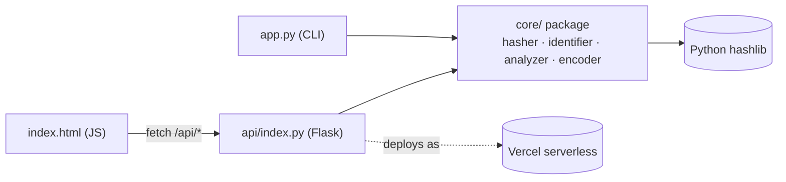

# 🔐 CyberHash Toolkit

[](https://github.com/<your-username>/CyberHash-Toolkit/actions)
[](LICENSE)
[](https://www.python.org/)
[](https://vercel.com/new)

**Live demo:** [cyber-hash-toolkit.vercel.app](https://cyber-hash-toolkit.vercel.app)

Learning-focused security utility for hashing, hash identification, and
hash analysis — available both as a **CLI** and a **web app** sharing the
same core logic. Core package is pure Python standard library, no
third-party crypto dependencies, so every algorithm call traces back to
`hashlib` and is easy to audit.

> **Educational use only.** Only hash/decode/crack data and hashes you own
> or have explicit permission to test. Bounded demo attacks exist to teach
> keyspace/weakness concepts, not to crack real credentials.

## Features

| Module | What it does |
|---|---|
| **Hash Generator** | 10 algorithms — MD5, SHA-1, SHA-224/256/384/512, SHA3-256/512, BLAKE2b/2s. Text or file input, each result tagged with a security badge (secure / weak / broken). |
| **Hash Identifier** | Guesses algorithm(s) from length/format/prefix, confidence-ranked (ambiguous lengths split confidence across candidates). |
| **Hash Analysis** | Compare two hashes · dictionary decoder · custom wordlist attack · hard-capped brute-force demo that prints keyspace size so you can *see* why length/charset matter. |
| **Encoding Tools** | Base64, Hex, URL encoding, ROT13 — encode and decode. |
| **History** | Recent operations logged locally (CLI: `data/history.json`; web: browser `localStorage`) — nothing sent anywhere else. |

### Engineering details worth noting
- **29 automated tests** (`pytest`, incl. Flask API tests) running on every push via **GitHub Actions** across Python 3.9/3.11/3.12.
- **Hard safety caps** on the brute-force/wordlist demos (bounded length, attempt ceiling) — intentional so the tool teaches concepts without being a usable cracking tool.
- **Naive rate limiting** on the two compute-heavy API endpoints, with its serverless limitation documented in-code rather than hidden.
- **Same core, two front ends** — CLI (`app.py`) and web (`api/index.py`) both call the identical `core/` package, no duplicated logic.
- Algorithm security metadata (`core/hasher.py: ALGO_INFO`) surfaces *why* MD5/SHA-1 are broken, not just that they are.

## Project structure

```
CyberHash-Toolkit/
├── app.py                 CLI entry point
├── vercel.json             Vercel routing config
├── requirements.txt
├── LICENSE                 MIT
├── .github/workflows/
│   └── tests.yml            CI: pytest on push/PR, 3 Python versions
├── api/
│   ├── index.py              Flask app (web UI + JSON API, rate-limited)
│   └── templates/
│       └── index.html        browser UI (badges, copy buttons, drag-drop)
├── core/
│   ├── hasher.py            text/file hashing + ALGO_INFO security metadata
│   ├── identifier.py        algorithm guessing
│   ├── analyzer.py          compare / decode / wordlist / brute-force
│   ├── encoder.py           base64 / hex / url / rot13
│   ├── wordlist.py          wordlist loader
│   └── history.py           local JSON history log (CLI only)
├── data/
│   └── wordlist.txt         sample dictionary for the demo attack
├── tests/                    pytest unit + API tests (29 total)
└── screenshots/
```

### Architecture



## Run it

Requires Python 3.9+.

```bash
git clone https://github.com/<your-username>/CyberHash-Toolkit.git
cd CyberHash-Toolkit
python3 app.py
```

No install step needed for normal use — `core/` is stdlib only. To run the
test suite, install the dev dependency and run pytest:

```bash
python3 -m venv venv
source venv/bin/activate        # Windows: venv\Scripts\activate
pip install -r requirements.txt
pytest
```

## Web version (Flask) + Vercel deploy

`api/index.py` wraps `core/` in a Flask app with a browser UI
(`api/templates/index.html`) so people can use it at a real URL instead of
the CLI. History lives in the visitor's own browser (`localStorage`), not
on the server — serverless storage is ephemeral. Brute-force/wordlist
limits are tighter here than in the CLI, and both endpoints are
rate-limited, to keep each request fast and abuse-resistant on serverless.

The web UI adds: per-algorithm security badges (secure/weak/broken) with
a one-line reason, one-click copy on every result, drag-and-drop file
hashing, loading states on the slower endpoints, and an in-browser About
tab. `/api/health` is there for uptime checks.

**Run it locally first:**
```bash
pip install -r requirements.txt
python3 api/index.py
```
Open http://localhost:5000

**Deploy to Vercel:**

1. Push the repo to GitHub (see below).
2. Install the CLI once: `npm i -g vercel`
3. From the project root:
   ```bash
   vercel login
   vercel
   ```
   Vercel reads `vercel.json`, installs `requirements.txt`, and builds
   `api/index.py` as a Python serverless function serving every route.
4. Confirm the prompts (link to new project, defaults are fine), then:
   ```bash
   vercel --prod
   ```
5. You'll get a URL like `https://cyberhash-toolkit.vercel.app` — that's
   the link to share in your post.

Alternative: skip the CLI and just import the GitHub repo at
vercel.com/new — it auto-detects `vercel.json` and deploys on every push
to `main`.

## Publish it (GitHub)

1. **Initialize git and commit** (from inside `CyberHash-Toolkit/`):
   ```bash
   git init
   git add .
   git commit -m "Initial commit: CyberHash Toolkit"
   ```
2. **Create a GitHub repo** (web UI, or with the CLI):
   ```bash
   gh repo create CyberHash-Toolkit --public --source=. --remote=origin
   ```
   Or create it manually on github.com, then:
   ```bash
   git remote add origin https://github.com/<your-username>/CyberHash-Toolkit.git
   ```
3. **Push:**
   ```bash
   git branch -M main
   git push -u origin main
   ```
4. **Polish the repo page:**
   - Add a short description + topics (`cybersecurity`, `hashing`,
     `python`, `flask`, `vercel`, `education`) in the GitHub sidebar.
   - Drop a screenshot or screen recording into `screenshots/` and
     reference it near the top of this README — portfolio visitors judge
     in the first 5 seconds.
   - `LICENSE` (MIT) and the GitHub Actions badge are already wired up;
     the badge turns green automatically after your first push.
5. **After deploying to Vercel (next section),** paste the live URL into
   the "Live demo" line at the top of this README and into your repo's
   About → Website field — a clickable live link is what makes a
   portfolio project stand out over a screenshot.
6. **Optional — make it pip-runnable:** add a `pyproject.toml` with a
   console-script entry point (`cyberhash = app:main`) if you want
   `pip install .` + `cyberhash` to work from anywhere.

## Disclaimer

Built for learning cryptographic hashing concepts (integrity checks,
identification heuristics, why weak/unsalted hashes are crackable). Not a
production security tool.
